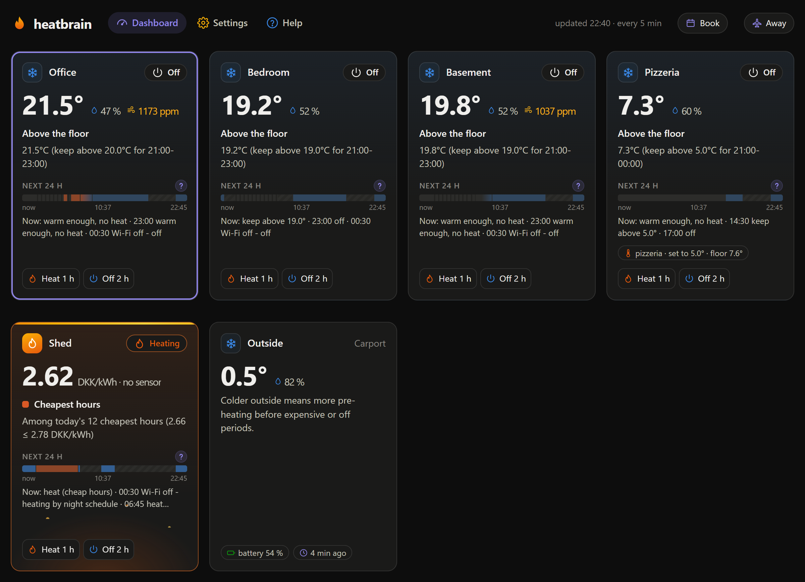
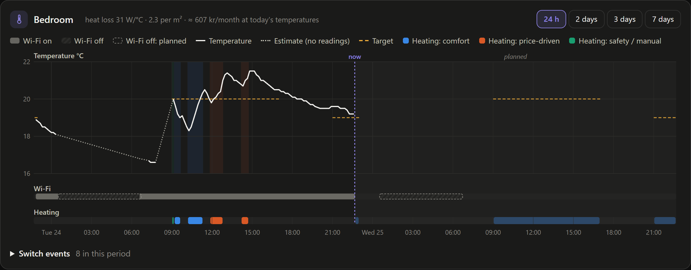
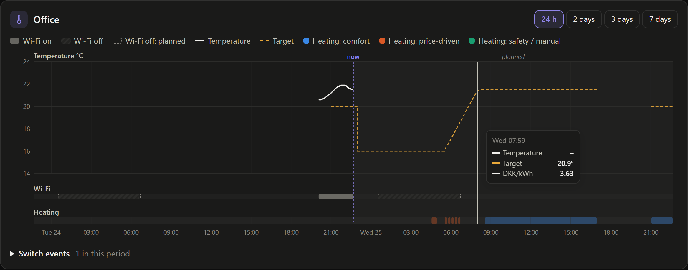
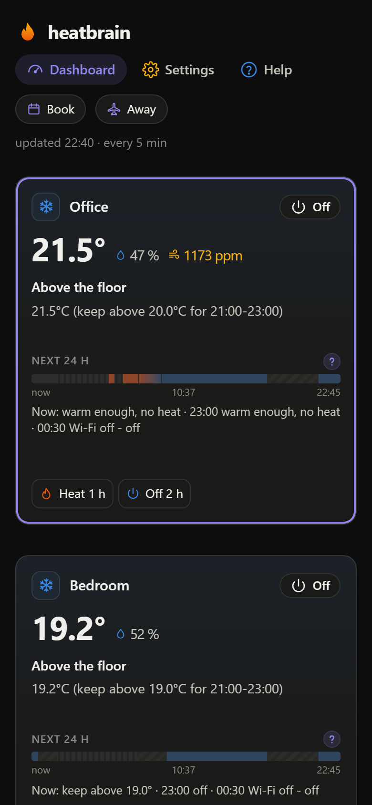
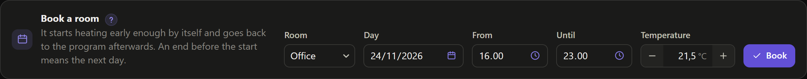
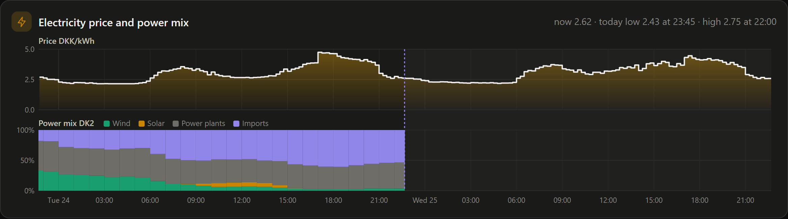
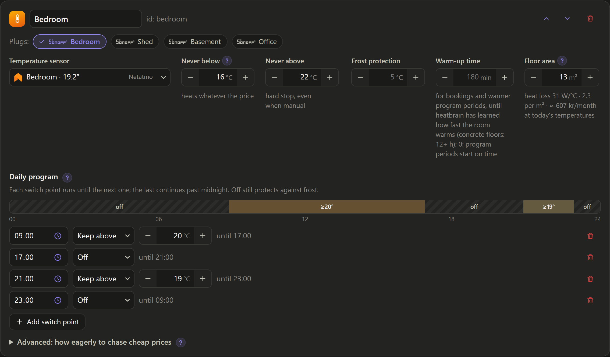
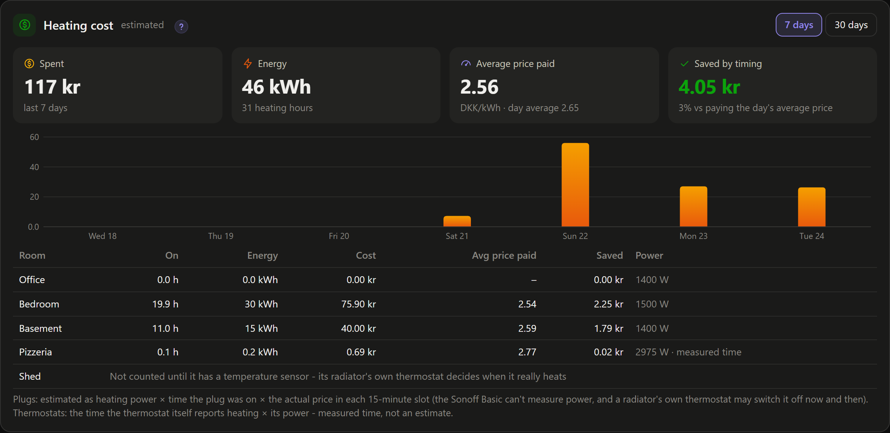
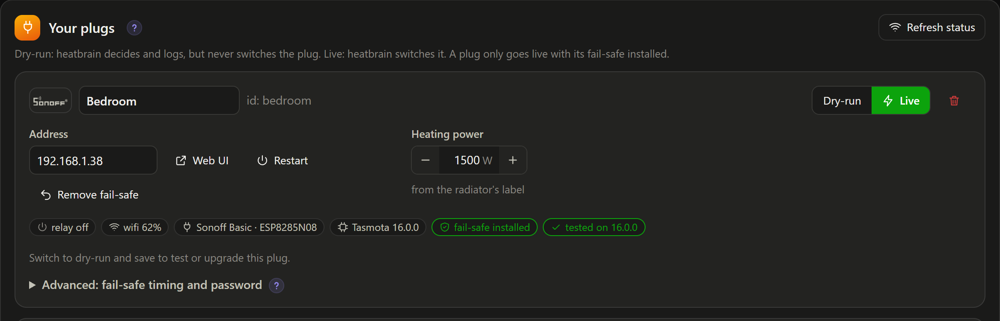
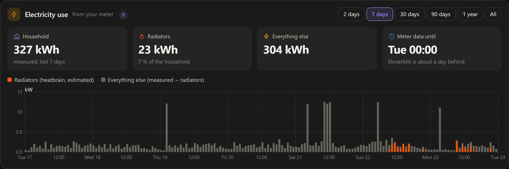

# heatbrain

**Electric heating that follows the electricity price, not just the thermostat.**

heatbrain decides, room by room, when the heaters should run. It uses the price of each
15-minute slot, the temperature in every room, the weather ahead and what it has learned about
how fast each room warms and cools. It then switches Tasmota smart plugs, or sets the setpoint
of DEVIreg Smart floor thermostats. It runs as one small C++ program with a web UI, in Docker on
a NAS or on a PC.



## What it does

- **Heats when it's cheap, coasts when it's dear.** Every 5 minutes each room is decided from
  its daily program and the prices for the next 24 hours. heatbrain pre-heats before expensive
  hours, lets the room cool a little during them and stores extra heat in the cheapest hours.
  On days with flat prices it is a plain thermostat.
- **Learns each room.** From its own history heatbrain learns how fast a room cools towards
  the outdoor temperature and how fast it warms when heated. Pre-heating is then calculated:
  just enough to coast through the whole expensive stretch, and started as late as possible,
  because stored heat leaks away. On a mild evening that can mean no pre-heating at all.
- **Warm when you need it.** When the program steps up (16° at night, 21.5° from 07:00), the
  room starts early: the target rises along a curve, worked out backwards from the room's own
  heating speed and the forecast, so it is warm when the period begins instead of starting to
  heat then. Bookings warm up the same way.
- **Looks at the weather ahead.** An hourly forecast from Open-Meteo (free, no account),
  corrected to your own outdoor sensor, sizes the pre-heating for the weather *during* the
  expensive hours.
- **Bookings.** "The pizzeria at 22° on Saturday 16-23": heatbrain works out when to start
  heating, from the room's current temperature, the forecast and what it has learned. That can
  be a day ahead for a concrete floor. Afterwards the room goes back to its program.
- **Away mode, Wi-Fi-off nights, open windows.** A planned away period keeps every room
  just above a floor. For a network that is switched off at night, a schedule is loaded onto
  each plug beforehand, and the plugs switch their own Wi-Fi off for the night too. A room whose
  temperature falls fast (a window open) pauses its heating for a while.
- **Watches the rooms themselves.** How well each room keeps its heat (heat loss in W/°C, per
  m² floor and per month in kroner), with a note when a room loses clearly more than the others
  or suddenly faster than its own normal. CO₂ from the room sensors, with a notification when the
  air gets poor (a high night comes as one message in the morning). Sensor batteries are warned
  about when they are projected to run out, not at a fixed level.
- **Safe by design.** Every plug carries its own dead-man switch and a limp-mode watchdog,
  so a crash or a lost network never means "heat forever" (see [Fail-safe](#fail-safe)).
- **Knows what it costs.** Cost per room per day, the average price paid against the market
  and what the timing saved, plus the household's real consumption from the meter
  (Eloverblik).
- **Tells you.** Alerts (plug unreachable, sensor offline, a room not warming up), a
  weekly summary, a monthly report and a heads-up when tomorrow is unusually expensive or
  cheap. Sent by ntfy (phone push without an account) or Discord.
- **Explains itself.** Every decision is logged with its reason, in plain language and with
  the inputs it was based on. Every setting has a "?" with the full explanation.

<table>
<tr>
<td colspan="2"><br><sub>Every decision on one time axis: temperature, target, Wi-Fi and the heating, coloured by why.</sub></td>
</tr>
<tr>
<td width="62%"><br><sub>Warming up: the target rises ahead of the 21.5° period, so the room is ready on time.</sub></td>
<td><br><sub>Works on the phone too.</sub></td>
</tr>
<tr>
<td colspan="2"><br><sub>Book a room: heatbrain starts heating early enough by itself.</sub></td>
</tr>
<tr>
<td colspan="2"></td>
</tr>
<tr>
<td></td>
<td></td>
</tr>
<tr>
<td></td>
<td></td>
</tr>
</table>

https://github.com/user-attachments/assets/9845e588-631f-49b3-be1a-e6ed30a5e829

## Hardware

| What | Supported | Notes |
|---|---|---|
| Heaters on smart plugs | Tasmota (e.g. Sonoff Basic R2, Basic R4), up to Tasmota 16 | heatbrain installs a fail-safe on each plug and tests it per firmware version; upgrades pick the image for the plug's chip (ESP8266, ESP32-C3, ...). The model is read from the plug and shown with its chip; Sonoff plugs carry the Sonoff mark |
| Floor heating | Danfoss DEVIreg Smart | paired from the DEVI app with a one-time code; heatbrain sets the setpoint and reads the floor temperature and real heating time |
| Room temperatures | Netatmo Weather Station (indoor modules), VELUX ACTIVE (wall switch / climate sensors), Shelly H&T Gen3, DEVIreg Smart's own sensors | VELUX: read from the VELUX app's cloud (unofficial; log in once, only the token is kept). Shelly: battery sensors send their readings to heatbrain (no cloud) |
| CO₂ | Netatmo indoor modules, VELUX ACTIVE | kept with the readings; notification above a chosen level |
| Outdoor temperature | Netatmo outdoor module, plus the Open-Meteo forecast | |
| Prices | Energi Data Service (DK1/DK2 spot, Danish grid tariffs) | any country via time-of-day `schedule` components |
| Meter data | Eloverblik (Danish smart meters) | hourly household consumption, about a day behind |

## Quick start (Docker)

```yaml
services:
  heatbrain:
    image: ghcr.io/bleze/heatbrain:latest
    restart: unless-stopped
    ports: ["8080:8080"]
    volumes: ["/volume1/docker/heatbrain:/data"]
    environment: ["TZ=Europe/Copenhagen"]
```

Open `http://<host>:8080` and set it up under **Settings**: prices, Netatmo, plugs, rooms.
Plugs start in **dry-run**: heatbrain decides and logs, but switches nothing until you set a
plug to Live. The web UI has no login: keep it on your home network and never forward a
router port to it. Full steps for a Synology NAS are under [Deployment](#deployment-synology-ds1821--any-docker-host).

# How it works

## Architecture

```
src/core/       Pure logic, no IO: time/DST, tariffs, price outlook, planner, thermal model,
                forecast, open-window detection, alerts, costs, insulation, air quality, batteries
src/net/        HTTP client + file cache (public APIs are rate limited)
src/providers/  Prices (Energi Data Service), meter data (Eloverblik), weather (Open-Meteo)
src/sensors/    Temperature sources (Netatmo, VELUX ACTIVE, pushed readings from Shelly H&T)
src/plugs/      Tasmota plugs with the on-plug fail-safe; a simulated plug for development
src/devices/    DEVIreg Smart thermostats (SecureDeviceGrid via OpenSDG)
src/storage/    SQLite history (decisions, temperatures, prices, meter readings)
src/notify/     ntfy and Discord
src/web/        HTTP server and JSON API for the web UI
src/app/        Config, CLI, the control loop, settings, digests, cost report
web/            The web UI: plain HTML/JS/CSS, no build step
```

Nothing in `core` knows about Denmark. Country-specific data sources live in `providers`
and are registered in `providers/price_model.cpp`.

### Price components

The price per kWh is a list of components in `heatbrain.json`, summed, then surcharges
(VAT) applied in order:

| type | What it is |
|---|---|
| `energidataservice.spot` | Day-ahead spot price for DK1/DK2 (15-minute resolution) |
| `energidataservice.tariff` | Danish grid tariffs from the Datahub price list (by GLN + charge codes) |
| `schedule` | Time-of-day bands with seasons/weekdays written in config: works for any grid company |
| `fixed` | Constant per kWh: taxes, supplier markup |

Adding a country means adding a spot provider (ENTSO-E covers all of Europe) and
describing its tariffs with `schedule`.

## Fail-safe

The radiators have analog thermostats set high, so heatbrain is effectively the thermostat.
A crash while a relay is ON must never mean "heat forever". All of this was verified on
Tasmota 14.6.0 (Sonoff Basic R2), including that re-sending ON restarts the PulseTime
countdown:

1. **Dead-man switch on the plug.** Every ON is sent with Tasmota `PulseTime` (~20 min):
   the relay turns itself OFF unless heatbrain keeps refreshing it.
2. **Limp mode on the plug.** A Tasmota rule watchdog (`RuleTimer`, re-armed by every
   heatbrain command) runs a bounded duty cycle (e.g. 10 min ON / 50 min OFF) when
   heatbrain goes silent: frost protection, never runaway heat.
3. **No heating on stale data.** If a room's temperature is older than ~30 min, heatbrain
   uses the same bounded profile instead of trusting old readings.
4. **Hard max temperature per room**, enforced by heatbrain; the analog thermostat stays as
   the last-resort cap.
5. `PowerOnState 0`: after a power cut, plugs start OFF until heatbrain takes over.

### Firmware and fail-safe test (Settings → Heaters)

- **Test fail-safe**: switches the relay on with a 20 s auto-off, refreshes it once (the
  countdown must restart) and checks the relay turns itself off; then restores the plug's
  settings. The result is recorded per firmware version.
- **Upgrade**: shown when GitHub has a newer Tasmota release. Only for dry-run plugs, one
  at a time: backs up the plug's settings, starts the over-the-air upgrade from
  ota.tasmota.com (same build variant; 1 MB devices pass through the minimal build), waits
  for the plug to come back on the new version, then runs the fail-safe test.
- A **live** plug is not switched if its firmware differs from the last version that passed
  the test, or if the test failed.
- **Restart** restarts the plug.

### Plug commands

```powershell
heatbrain discover 192.168.1.0/24   # find Tasmota devices
heatbrain plugs                     # status + fail-safe check of configured plugs
heatbrain plug bedroom provision    # back up settings, install fail-safe, disable device timers
heatbrain plug bedroom on|off       # ON refused unless the fail-safe is installed (--force)
heatbrain plug bedroom restore      # put back the latest backup (data/plugs/<id>/)
```

Plugs default to `"mode": "dryrun"`: the planner will only switch plugs set to `"live"`.
Only provision a plug once heatbrain runs continuously; otherwise it enters limp mode.

## Rooms and the planner

Each room has plugs, a sensor (`"netatmo:Bedroom"`, by module name or id), `minTemp`,
`maxTemp` and a **daily program** of switch points, each running until the next one (the
last continues past midnight): **heat to X** (price-aware), **keep above X** (a floor only:
no pre-heating or boosting) or **off** (only frost protection, e.g. the 17-21 peak tariff or
the night). Older configs with `schedule` bands and `noHeat` windows are converted
automatically. Rooms without a sensor use `priceOnly`
(run the N cheapest hours per day, with no-heat windows). Every tick (default 5 min) the
planner decides each room, checking in this order:

| # | Rule | Reason code |
|---|---|---|
| – | A booking replaces the program (heat to its target, from the warm-up start until its end, never coasting); an away period replaces it with "keep above" | |
| 1 | At/above `maxTemp`: OFF, even with manual ON | `ABOVE_MAX` |
| 2 | Manual override (OFF still heats below `frostTemp`) | `MANUAL_ON`, `MANUAL_OFF`, `FROST_PROTECTION` |
| 3 | Temperature fell fast (1 °C within 30 min): window open? Paused for 30 min | `WINDOW_OPEN` |
| 4 | Program says off: only frost protection | `SCHEDULED_OFF` |
| 5 | Temperature missing or older than 30 min: 10 min ON / 50 min OFF | `STALE_DATA_LIMP` |
| 6 | Keep-above period (or away): heat only below the floor | `KEEP_ABOVE`, `KEEP_SATISFIED` |
| 7 | Below `minTemp`: ON whatever the price | `BELOW_MIN` |
| 8 | Expensive slot: coast down to target − 1.0 °C | `PEAK_AVOID`, `BELOW_COMFORT_DURING_PEAK` |
| 9 | Expensive slot within 3 h and clearly cheaper now: pre-heat (see below) | `PREHEAT_BEFORE_PEAK` |
| 10 | Among the cheapest slots: heat to target + 0.5 °C | `CHEAP_BOOST` |
| 11 | Warming up for a warmer period ahead (see below): heat below the curve | `WARM_UP`, `WARM_UP_ON_TRACK` |
| 12 | Thermostat with ±0.3 °C hysteresis | `BELOW_TARGET`, `TARGET_REACHED`, `HOLD_ON`, `HOLD_OFF` |

"Expensive" = top quarter of the next 24 h *and* 15% above the median; "cheapest" = bottom
quarter *and* 10% below the median, so flat-price days fall back to a plain thermostat.
All margins are configurable per room (`strategy`).

**Pre-heating.** Until a room's heating model is learned, it heats to target + 1.0 °C, scaled
×0.5–1.5 by the outdoor temperature expected during the expensive hours (forecast, else the
outdoor sensor now). Once learned, heatbrain calculates instead: the temperature the room must
have when the expensive stretch starts so that, cooling towards the forecast outdoor
temperature at its learned rate, it ends the stretch no lower than target − the allowed drop.
That is capped at twice the pre-heat setting, and pre-heating only starts as early as heating
that far takes.

**Warming up for the program.** When the program steps up by at least 0.5 °C within 12 h
(from a heat or keep-above period, never out of an off period), the target becomes a curve
towards the new one instead of a jump: at each moment, how warm the room must be so that full
heat still reaches the new target 30 minutes before the period starts. With a learned heating
model it is the room's own full-heat curve (gain × 0.8, for the forecast outdoor temperature);
until then a straight ramp over the room's warm-up setting (`warmupMinutes`, 0 = start on time).
It is eased into both ends, so the chart's target line rises as an S. Towards a heat period rules
8-10 still apply to it (coast in expensive slots against the curve, pre-heat before them); towards
a keep-above period, like the period itself, price does not matter. The night schedule heats
a warm-up inside the Wi-Fi off period at full power, and thermostats get the new target at once.

**The heating model.** `dT/dt = gain · heating − loss · (T − T_outdoor)`, fitted per room from
the last 21 days of decisions (90-minute stretches of steady heating or not; limp mode, night
schedules and open windows are left out) and refitted hourly. It is used once it has seen at
least three cooling and three heating stretches. It also gives bookings their warm-up time
(×1.25 + 30 min, at most 48 h), program steps their warm-up curve and the "Next 24 h" plan its "warm enough, no heat" periods.

**Weather forecast.** Hourly temperatures for two days from Open-Meteo, for the position of the
Netatmo station or a place searched in Settings → Climate (only the position, rounded to about
1 km, is sent). It is corrected to the outdoor sensor: the difference measured now fades out
over six hours.

**Thermostats.** A room can have a DEVIreg Smart instead of plugs. In Live, heatbrain puts the
thermostat in manual mode and sets its setpoint from the decision (target, pre-heat or boost
ceiling, the coasting floor, or frost protection when off); the thermostat regulates by itself
and keeps its last setpoint if heatbrain is gone. Pairing uses a one-time code from the DEVI
app's "Share house".

**Away mode** is a planned period (from – until, set from the dashboard's Away button,
stored in `data/away.json`): every room only keeps above the chosen temperature, price-only
rooms stay off, and it starts and ends by itself.

**Wi-Fi off period** (Settings → System, `"wifiOff": {"from": "23:30", "to": "06:30"}`): for a
network that is switched off at night. Shortly before, heatbrain loads a schedule onto each live
plug (Tasmota Rule2/Rule3, `Time#Minute` triggers on the plug's own clock) and stretches the
fail-safe to match: auto-off just longer than the longest planned ON, watchdog until the end
of the schedule plus 30 min. The schedule reaches 3 h past the planned end (a late Wi-Fi is not
limp mode); fresh sensor readings mean the network is back and heatbrain takes over at once.
Optional `"weekend": {"from", "to"}` for the nights ending Saturday/Sunday. On Tasmota 15.4.0 or
newer the plugs also switch their own Wi-Fi off: `Wifi 0` one minute after the period starts and
`Wifi 1` two minutes before it ends, as part of the night schedule (`"plugWifi": false` to keep
it on). Settings shows the
real off times of the last week from gaps in the Netatmo readings, and suggests a period. Without Wi-Fi there are no temperatures either, so heat/keep periods heat the
share of time the room actually heated in such periods over the last 7 days (25 % until there
is enough history), in the cheapest quarters; price-only rooms get their cheapest hours.
Expected plug/sensor outages are not reported during the period and 20 minutes after.

**Plan preview:** each room card shows the next 24 h worked out from the program, the known
prices, bookings and the forecast (heat / pre-heat / coast / boost / warm up / keep / booked /
away / off, and "warm enough, no heat" where the room is predicted to stay above what the period
asks); a warm-up blends from the period before into the one after.

**Bookings** (the dashboard's Book button, stored in `data/bookings.json`): a target
temperature from – until. Warming up starts by itself as early as the room needs, along the same
curve as a program step, from what the program would have had - regardless of price, and a room
already warmer than the curve waits. In the room chart the target line is violet wherever a
booking sets it, with a band over the warm-up and the booking.

### Decision log

Every tick stores one decision per room in SQLite (`data/history.db`, kept 3 years - about 100 MB a year with four rooms; daily summaries per sensor and the battery history are kept for good): ON/OFF,
whether it changed, reason code, plain-language detail, a snapshot of the inputs
(temperature and age, target, price, median) and what happened at each plug. Temperatures
and prices are stored too, for the web UI's graphs.

```powershell
heatbrain plan                       # what every room would do now, and why
heatbrain run                        # the control loop
heatbrain history bedroom            # switch events of the last 24 h  [--hours 72] [--all]
heatbrain override bedroom on 60     # manual ON for 60 min (picked up by a running 'run')
heatbrain override bedroom clear
```

## Web UI

`heatbrain run` serves a web UI on port 8080 (`web` in config; no login, keep it on your
home network): problems banner, a card per room (temperature, decision and reason, the next
24 h, "Heat 1 h" / "Off 2 h" / "Book"), per room a chart of temperature + target (a warm-up drawn
as a curve, a booking in violet), heating
periods coloured by reason category (comfort / price-driven / safety-manual), Wi-Fi off
periods, with the planned hours ahead, plus the switch events; under it, on the same time axis,
the electricity price (every known price ahead) and the power mix of the price area (wind, solar,
power plants, imports and CO2 per hour, from Energinet's open data) - each can be switched off
in Settings → System; then heating cost and meter data. The outdoor card opens the same chart for the outdoor temperature. Overrides
from the UI are applied immediately. **Settings** edits everything in the config (rooms and
programs, plugs incl. fail-safe and firmware upgrades, sensors, prices, notifications,
system) with validation and backups. It is arranged as Rooms, Heaters, Sensors (the sensor
connections and a card per module with its readings, battery and charts from 2 days to a year),
Climate (outdoor sensor, weather forecast, open windows, air quality), Prices, Notifications
and System; **Help** explains every feature, and "?" buttons show
the same text next to the settings. Light/dark/system theme. The frontend is plain HTML/JS in `web/` (no build step); in dev builds it is served
straight from the source folder, so edits only need a browser refresh.

## Heating cost and meter data

The dashboard shows what each room's heating costs: for plugs, on-time from the decision log ×
the heating power (Settings → Heaters) × the actual price in each 15-minute slot; for
thermostats, the heating time the thermostat itself reports × its power. It shows cost, energy,
the average price paid against each day's average price, and what the timing saved. Dry-run
plugs show what they *would* have cost. The Sonoff Basic has no power metering, so plug
figures are estimates.

With an Eloverblik token (Settings → Prices), heatbrain also fetches the household's hourly
consumption from the meter and shows it next to the heating: household, heating, everything
else.

## Notifications

Pluggable notifiers selected in config: **`ntfy`** (phone push without an account: install
the ntfy app and subscribe to a random topic; optional token for self-hosted servers) and
`discord` (channel webhook). Set up and test from Settings → Notifications.

Digests (each optional): a weekly cost summary on Monday at 08:00; a monthly report on the
1st (cost per room, the average price paid against the market, the dearest day, and the energy
against the month before); a heads-up at 14:00 when tomorrow is at least 20 % more expensive or
cheaper than the past week; and a message when a new Tasmota release is out for your plugs.

Alerts: plug unreachable, plug state differs from commanded state, Netatmo re-login
required, Netatmo module offline, a sensor battery that will run out within about three weeks
(or before a planned away period ends), poor air (CO₂ above the chosen level for 20 minutes),
a room losing heat much faster than usual, stale temperature (room in limp mode),
tomorrow's prices missing by ~15:00, room below minimum despite heating (open window /
radiator off), window open (heating paused), thermostat unreachable, a live plug whose
fail-safe is not verified, heatbrain restarted.

Rules: alert only after a problem persists (debounce), send a "resolved" message on
recovery, repeat ongoing problems at most every few hours, optional quiet hours for
non-urgent alerts. Active problems also show as a banner in the web UI and in the room's
decision log.

## Deployment (Synology DS1821+ / any Docker host)

Every push to `main` builds the image with GitHub Actions (unit tests run inside the
Docker build) and publishes `ghcr.io/bleze/heatbrain:latest` (plus a `sha-…` tag).

1. **Registry access.** GHCR packages start private. Either make the `heatbrain` package
   public (GitHub → Packages → heatbrain → Package settings), or on the NAS log in with a
   personal access token that has `read:packages`:
   `sudo docker login ghcr.io -u bleze`.
2. **Data folder.** Create `/volume1/docker/heatbrain` (empty is fine: heatbrain creates a
   starter config on first run).
3. **Container Manager → Project → Create**, paste `deploy/docker-compose.yml`, start.
   The web UI is at `http://<nas-ip>:8080`.
4. **Move your setup.** On the old heatbrain: Settings → System → *Export* (tick "Include
   history" to keep graphs and costs). On the NAS: Settings → System → *Import* that file.
   It carries the config with passwords, the Netatmo login, plug backups and fail-safe test
   results, the away period and overrides. Delete the file afterwards: it contains secrets.
5. **Only one heatbrain at a time.** Stop the old one right after importing. Netatmo rotates
   its refresh token on every refresh, so two copies lock each other out - and both would
   switch the plugs.
6. Other commands run inside the container, e.g.
   `sudo docker exec heatbrain /app/bin/heatbrain plugs`.
7. **Going live, one plug at a time:** Settings → Heaters → *Install fail-safe*, *Test
   fail-safe*, then switch the plug to Live and save. *Remove fail-safe* undoes it.

**Updating.** Container Manager does not check ghcr.io images for updates (and *Build* reuses
the local image). Copy `deploy/update.sh` into `/volume1/docker/heatbrain/` and add it in
Control Panel → Task Scheduler → Create → Scheduled Task → User-defined script (user `root`,
command `sh /volume1/docker/heatbrain/update.sh`), daily or run by hand. It pulls the newest
image, restarts heatbrain only if it changed and removes the old image.

## Development (Windows, Visual Studio 2026)

Open the folder in Visual Studio, select the **Windows Debug (local dev)** preset, and build.
vcpkg (bundled with VS) installs the dependencies on first configure.

From a terminal:

```powershell
./scripts/dev.ps1 build
./scripts/dev.ps1 test
./scripts/dev.ps1 run prices          # hourly prices today + tomorrow
./scripts/dev.ps1 run prices --slots  # 15-minute slots
```

Debug builds keep their data in `./data` (git-ignored): `heatbrain.json` is created from
`config/heatbrain.example.json` on first run, and API responses are cached in `data/cache`.

## License

heatbrain is free software under the **GNU General Public License v3.0** (see `LICENSE`).
It includes [OpenSDG](https://github.com/Sonic-Amiga/opensdg) (GPL-3.0, `third_party/opensdg`)
to talk to Danfoss DEVIreg Smart thermostats over Trifork's SecureDeviceGrid, a proprietary
protocol; that support is meant for controlling your own thermostats, not for commercial use.
